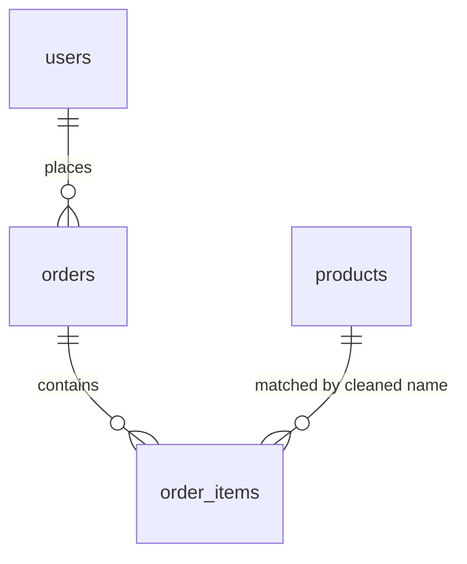

# Much Ado About Baskets — Grocery Basket Analysis & Bundle Promotions

> Clean messy grocery-marketplace orders, uncover which products are bought together, and turn that into targeted promotion recommendations.

---

## The business question

"Nearby Basket" is a grocery delivery marketplace. The merchandising team wants to launch **bundle promotions** and asked: *which products naturally belong together, for which customers, and which promotions are worth testing?*

The catch: the data is messy — free-text product names, inconsistent region labels, cancelled and returned orders mixed in, and a test promo code sitting in production data.

## Data

Four related tables, March–May 2026:

| Table | Content | Size (after cleaning) |
|---|---|---|
| `users` | Sign-up date, home region, acquisition channel, loyalty tier | 150 customers |
| `orders` | Timestamp, delivery region, device, promo code, status, discount, order value | 523 completed orders |
| `order_items` | Product (free text), quantity, unit price | 2,116 line items |
| `products` | Product name, category, fresh / non-fresh flag | 44 products |

---

## Solution process

1. **Standardise product names** — `strip → lower → spaces to underscores` on both sides, because `order_items` joins to `products` by *name*, not by an ID. Verified **0 unmatched products** before joining.
2. **Build one master table** — `order_items → products → orders → users` with left joins.
3. **Filter to valid sales** — completed orders with positive quantity and price only (2,136 → 2,116 rows), so cancelled/returned orders don't inflate revenue. Derived `line_revenue`, week/month and a `used_promo` flag.
4. **Basket overview** — basket-size distribution, top products, revenue by category, fresh vs. non-fresh.
5. **Product affinity** — every product pair per order, then:
   - **support** = share of orders containing both products,
   - **lift** = support ÷ (frequency A × frequency B). Lift > 1 means the pair is bought together *more than chance*. Lift — not raw counts — separates genuine affinity from "both are just popular".
   - A co-purchase heatmap for the top 12 products.
6. **Trends** — weekly revenue, orders and average order value; orders by weekday; promo usage over time.
7. **Customer segmentation (RFM)** — Recency, Frequency, Monetary quartile scores mapped to Champions, Loyal, New, At Risk, Hibernating, Lost.
8. **Promotions, regions, devices** — performance of each promo code, promo vs. non-promo baskets, regional and device breakdowns.
9. **Stakeholder memo** — data-quality notes, five "tempting shortcuts" that lead to wrong promotions, key findings, four promotion tests and a "what not to do" list.

---

## Key findings

**Baskets**
- Average basket: **5.2 items** (median 5). Pantry is the largest revenue category (₪12.5K of ~₪31.9K); produce sells the most units.
- Fresh items appear in more orders than non-fresh (495 vs. 378) but at roughly half the line value (₪11.4 vs. ₪21.7).

**Natural bundles (from lift)**

| Cluster | Products | Orders together | Lift |
|---|---|---|---|
| Breakfast | banana · granola · honey · plain yogurt | 79 (every pair) | 6.6 |
| Mexican snack | avocado · salsa · tortilla chips | 59 (every pair) | 8.9 |
| Hosting / snack | grapes · hummus · sparkling water · cheese crackers · pita · olives | 8–11 | 9.0–13.1 |
| Salad base | tomato · white onion · cucumber | 88–135 | 2.3–3.0 |

The salad base is the most *frequent* combination but has the *lowest* lift: these are staples people already buy together. Discounting them would give away margin without growing baskets — the opposite of what a frequency-only analysis would suggest.

**Promotions**
- 25.8% of orders used a promo code. `FRESHAPRIL` was used most (54×) but on the smallest orders (₪40.5 average); `BREAKFAST10` came with the largest orders (₪93.6).
- Promo baskets were larger (6.1 vs. 5.0 items; ₪66.9 vs. ₪59.1) — but promo users self-select, so this is **not** proof the promos caused it.
- A `TEST` code appears 8 times with ₪0 discount — test data leaking into production.

**Data quality**
- Five delivery regions were recorded in **30 spelling, case and whitespace variants** (`center`, ` CENTER`, `Center`…), which would split any regional analysis.
- Revenue is spread fairly evenly: the top 20% of customers drive only ~30% of revenue.

## Recommendations (v1 memo)

1. **High-lift bundle test** — bundle top-lift products, measure incremental basket size against a control group.
2. **Reactivation offer** for the Hibernating segment (10–15% off the next order, measured as 14-day reactivation).
3. **Second-order nudge** for new customers (small incentive within 7 days of the first order).
4. **Cross-category bundle** (fresh + pantry) for single-category shoppers, while monitoring spoilage and returns.

**What not to do:** blanket-discount staples, discount Champions who already pay full price, judge promos by comparing users to non-users, or roll out one region's result nationally.

---

## Feedback & next iteration

The submission was reviewed after completion.

**Strengths noted:** the "tempting shortcuts" and "what not to do" sections (thinking beyond the code about how analysis gets misused), the correct choice of lift over popularity, and a clear, professional structure.

**What I'd change in v2:**

| Review point | Planned fix |
|---|---|
| RFM groups customers by *how often* they buy, but bundles need *what* they buy | Segment on product behaviour: build a customer × category share matrix and cluster it (e.g. fresh-cooking, breakfast, snacking/hosting), then match each high-lift bundle to the segment that buys it |
| Duplicate rows in `order_items` were not removed, inflating pair counts | De-duplicate line items before computing support and lift |
| Trend analysis stayed at the total level | Slice trends by category — the review pointed to a rising share of fresh-cooking items over time, the biggest growth opportunity in the data |
| Region labels not normalised | `strip().lower()` region names before any regional split; drop the `TEST` promo code |

> Note: the figures above come from the v1 submission and include the duplicate line items flagged in the review.

---

## Files

| File | Description |
|---|---|
| `basket_analysis.ipynb` | Submitted notebook with code and printed outputs (charts not included) |

The dataset belongs to XP Lab and is not redistributed. The notebook ran in XP Lab's hosted environment, where the tables were preloaded as `df_users`, `df_orders`, `df_order_items` and `df_products`.

**Tools:** Python · pandas · NumPy · matplotlib · seaborn · itertools

**Challenge:** [XP Lab](https://www.xp-lab.com) — "Much Ado About Baskets"

[← Back to FP&A projects](../README.md)
