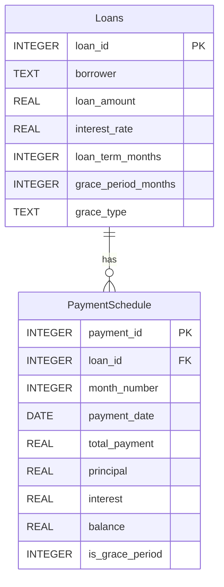

# Loan Amortization Schedule Calculator

> How much do you pay each month on a loan, how much of it is interest vs. principal, and what does a grace period really cost?


---

## The problem

Every loan payment has two parts: **interest** (the price of borrowing) and **principal** (paying back the money itself). An **amortization schedule** shows, for every month, how much is paid, how it splits between interest and principal, and how much debt is left.

Lenders and finance teams need this calculated reliably, stored in a database, and summarised on demand. They also need to handle **grace periods**: months at the start of a loan where the borrower pays less (interest only) or nothing at all.

**Goal:** build a tool that

1. stores loans in a SQL database,
2. generates a full schedule using the **Spitzer method** (fixed monthly payment, the standard method for Israeli mortgages and business loans),
3. supports **partial** and **full** grace periods,
4. saves every month as a row and produces a summary with a SQL query.

## What this project demonstrates

| Area | In this project |
|---|---|
| Financial modelling | Spitzer (annuity) formula, interest/principal split, grace periods, cost of grace |
| Database design | Two tables in a one-to-many relationship, primary and foreign keys |
| SQL | `CREATE TABLE`, `INSERT OR REPLACE`, `DELETE`, `LEFT JOIN`, `GROUP BY`, `SUM`, `COUNT` |
| Python | Class design, `sqlite3`, parameterised queries |

---

## Key concepts

| Term | Plain-language meaning |
|---|---|
| Principal | The amount borrowed |
| Balance | How much of the principal is still unpaid |
| Annual rate | Yearly interest on the balance; divided by 12 for the monthly calculation |
| Spitzer schedule | The **monthly payment is fixed**. Early payments are mostly interest, later ones mostly principal |
| Partial grace | Pay interest only during grace; the debt does not shrink |
| Full grace | Pay nothing during grace (see [Assumptions](#assumptions--limitations)) |

---

## Database design

One loan → many schedule rows (**one-to-many**):



**Why two tables?** Loan details appear once; payment rows appear many times. In a single table, the borrower's name and loan amount would be repeated 48 times. `loan_id` in `PaymentSchedule` is a **foreign key** pointing back to the loan.

---

## Solution process

### 1. Create the tables
`CREATE TABLE IF NOT EXISTS` creates the tables only if they don't already exist, so re-running the script never wipes data.

### 2. Add a loan
`add_loan()` inserts a row into `Loans`. Values are passed with `?` placeholders instead of being pasted into the SQL string. This prevents bugs (e.g. a name containing an apostrophe) and protects against SQL injection. `INSERT OR REPLACE` makes re-runs safe.

```python
calculator.add_loan(loan_id=1, borrower='Israel Israeli', loan_amount=100000,
                    interest_rate=5.00, loan_term_months=48,
                    grace_period_months=6, grace_type='partial')
```

### 3. Calculate the fixed monthly payment (Spitzer formula)

```
M = P × r(1+r)^n / ((1+r)^n − 1)
```

| Symbol | Meaning |
|---|---|
| `M` | Monthly payment |
| `P` | Principal |
| `r` | Monthly rate = annual rate ÷ 12 ÷ 100 |
| `n` | Number of repayment months, **excluding** grace months |

- **Why exclude grace months?** During grace the principal doesn't shrink, so all of it must be repaid in the remaining months.
- **Edge case, 0% interest:** the formula divides by zero, so the code simply splits the principal evenly.

### 4. Build the schedule month by month
For each regular month:

```
interest   = balance × monthly rate
principal  = fixed payment − interest
new balance = balance − principal
```

**Why does interest fall over time?** Interest is charged on the balance. The balance shrinks every month, so interest shrinks too, and because the payment is fixed, the savings go to principal.

During grace months:

| Grace type | Payment | Interest | Principal | Debt |
|---|---|---|---|---|
| `partial` | Interest only | balance × monthly rate | 0 | Unchanged |
| `full` | 0 | 0 | 0 | Unchanged (in this model) |

### 5. Save and print
Every month is saved as a row in `PaymentSchedule` and printed as a table row. Old rows for the same loan are deleted first, so re-running recalculates the schedule instead of duplicating it.

### 6. Summarise with SQL

```sql
SELECT
    l.borrower,
    l.loan_amount,
    l.interest_rate,
    COUNT(p.payment_id) AS total_payments,
    SUM(p.interest)     AS total_interest,
    SUM(p.principal)    AS total_principal
FROM Loans l
LEFT JOIN PaymentSchedule p ON l.loan_id = p.loan_id
WHERE l.loan_id = ?
GROUP BY l.loan_id;
```

- **`GROUP BY`** collapses all of a loan's payment rows into one summary row.
- **`LEFT JOIN`, not `JOIN`:** a loan with no schedule yet still shows up (with 0 payments) instead of disappearing. `SUM` returns `NULL` in that case, and the code displays 0.

---

## Results (actual output)

### Example 1 — business loan with 6 months of partial grace

| Parameter | Value |
|---|---|
| Principal | ₪100,000 |
| Annual rate | 5% |
| Term | 48 months, of which 6 are partial grace |

| Month | Payment | Interest | Principal | Balance | Grace |
|---|---|---|---|---|---|
| 1 | 416.67 | 416.67 | 0.00 | 100,000.00 | yes |
| … | … | … | … | … | … |
| 6 | 416.67 | 416.67 | 0.00 | 100,000.00 | yes |
| 7 | 2,600.30 | 416.67 | 2,183.64 | 97,816.36 | – |
| 8 | 2,600.30 | 407.57 | 2,192.74 | 95,623.63 | – |
| … | … | … | … | … | … |
| 47 | 2,600.30 | 21.53 | 2,578.77 | 2,589.51 | – |
| 48 | 2,600.30 | 10.79 | 2,589.51 | 0.00 | – |

**Summary:** 48 payments, total interest **₪11,712.74**, total principal ₪100,000.

**What the numbers show**
- In months 1–6 only interest is paid (100,000 × 5% ÷ 12 = ₪416.67) and the debt doesn't move.
- From month 7 the payment is fixed, but its split changes: interest falls from ₪416.67 to ₪10.79 while principal rises.
- **The cost of grace:** the same loan without grace (48 payments of ₪2,302.93) would cost ₪10,540.61 in interest. The grace period adds about **₪1,172** of interest — a number a borrower or a credit committee can actually decide on.

### Example 2 — interest-free loan

| Parameter | Value |
|---|---|
| Principal | ₪30,000 |
| Annual rate | 0% |
| Term | 30 months, no grace |

Every month: payment ₪1,000, interest ₪0, principal ₪1,000. **Summary:** 30 payments, total interest ₪0.

---

## Assumptions & limitations

- **Full grace:** in this model nothing is paid and no interest accrues. In practice banks usually keep accruing interest and capitalise it (add it to the principal), so the debt grows. To make it realistic, add each grace month's interest to the balance.
- **Fixed rate only:** no prime-linked or CPI-linked loans.
- **Payment dates:** every 30 days from the run date, not a fixed day of the month, so dates change between runs.
- **Rounding:** values are stored unrounded and displayed to 2 decimals, so displayed rows may differ from the summary by a few agorot.

---

## How to run

No installation needed — only the Python standard library (`sqlite3`, `datetime`).

```bash
python amortization_calculator.py
```

This creates `loans.db` next to the script, adds the two example loans, and prints each schedule and summary. Re-running recalculates everything.

### Calculate your own loan

```python
from amortization_calculator import AmortizationCalculator

calc = AmortizationCalculator('loans.db')
calc.add_loan(3, 'Dana Levi', 250000, 4.5, 120, grace_period_months=12, grace_type='partial')
calc.generate_payment_schedule(3)
calc.show_summary(3)
```

### Useful queries on `loans.db`
Open the file in DBeaver or DB Browser for SQLite:

```sql
-- Interest and principal paid in grace months vs. regular months
SELECT
    is_grace_period,
    COUNT(*)       AS num_payments,
    SUM(interest)  AS total_interest,
    SUM(principal) AS total_principal
FROM PaymentSchedule
WHERE loan_id = 1
GROUP BY is_grace_period;
```

---

## Files

| File | Description |
|---|---|
| `amortization_calculator.py` | Full source code |
| `loans.db` | Created on run (not stored in the repo) |

**Tools:** Python · SQLite · SQL

[← Back to FP&A projects](../README.md)
